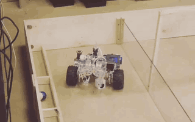
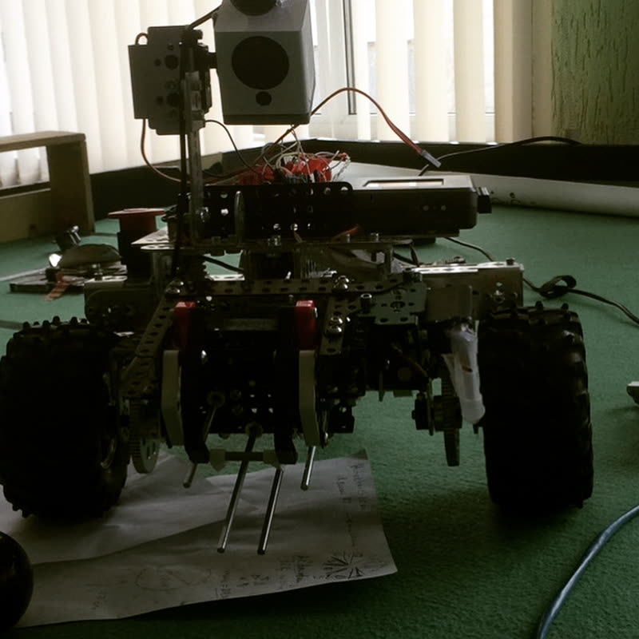
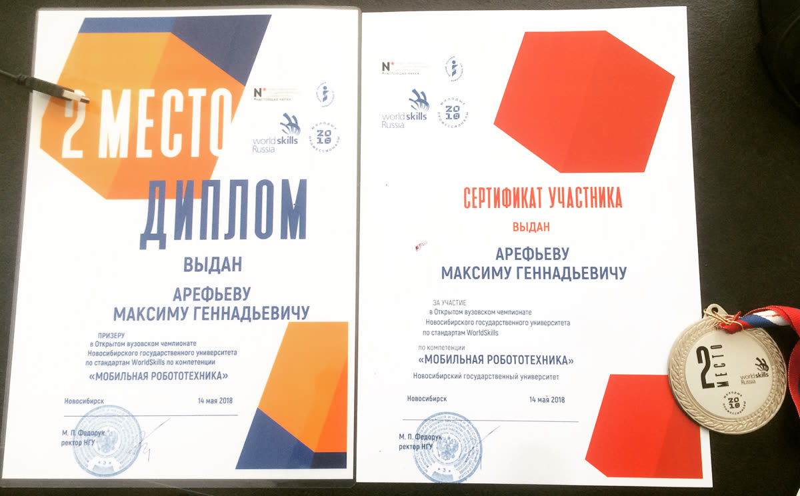

# Mobile Robotics: 2nd place, 2018

LabVIEW code of the robot my team built for the NSU Open University Championship (WorldSkills standards), "Mobile Robotics" skill. Novosibirsk, May 2018.

  
  

## The task

- The robot is controlled remotely with a joystick over Wi-Fi, both in direct view and with limited view, by the camera image only
- The claw picks up billiard balls. A QR code above each pocket tells which color goes there, and the robot drops the ball only into the right pocket
- The bonus goal was full autonomy without an operator. No team managed it, including ours

## Team

- **Me:** programming
- **Teammate** (senior student): design and assembly of the robot
- **Mentor:** our physics professor

## What I did

- **Motion model.** Together with the professor I worked out the equations for the robot: wheel radius, distance between the wheels, two driven front wheels and a rear wheel with balls around it for turning. With this model the robot drives a set distance and turns by a set angle (`Move.vi`, `Turn.vi`, `1m forward.vi`, `1m back.vi`)
- **Competition program.** The organizers published an extra program for the participants a day before the competition. I measured distances and angles on the field with a tape measure and filled the program with calls of our move and turn functions
- **Wi-Fi link.** At the venue we scanned the load of Wi-Fi channels and picked the cleanest one for a stable link
- **Video stream** from the robot camera to the operator

## How it works

| Runs on                | File                        | Role                                                                                    |
| ---------------------- | --------------------------- | --------------------------------------------------------------------------------------- |
| Operator PC            | `PC RC.vi`                  | Reads the joystick and sends commands to the robot                                      |
| myRIO, real-time CPU   | `Main.vi`                   | Main logic: moving, turning, grabbing, releasing, QR recognition, ultrasonic checks     |
| myRIO, FPGA            | `FPGA/`                     | Hardware level: DC motor control, claw, servo PWM, Parallax PING))) distance sensors    |

Other files:

- `Move.vi`, `Turn.vi`: movement by distance and angle based on the motion model
- `Grab.vi`, `Release.vi`, `ServoPWM*.vi`: the claw
- `Pattern Recognition.vi`: reads the QR code from the camera (NI Vision)
- `US Check*.vi`: ultrasonic distance checks
- `FPGA Bitfiles/`: compiled FPGA images and route programs

## Stack

NI myRIO-1900, LabVIEW 2017 (Real-Time, FPGA, Vision), Parallax PING))) ultrasonic sensors, USB joystick, Wi-Fi.

## How to open

`.vi` files are binary, so GitHub can't show them. You need LabVIEW 2017 or newer with the Real-Time, FPGA, myRIO and Vision modules. Open `Badass Loader.lvproj`. The FPGA part is already compiled in `FPGA Bitfiles/`.

The code is uploaded in 2026 from my archive. I only removed drafts and copies, the rest is as it was in 2018.

## Result

2nd place, diploma and medal:

More about me: [czenturion.github.io/cv](https://czenturion.github.io/cv/)
